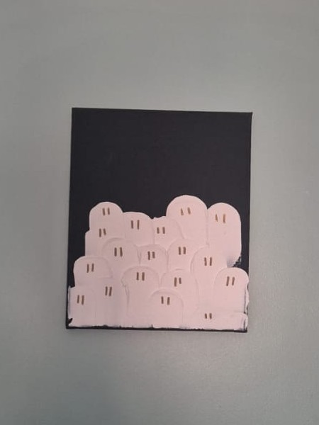
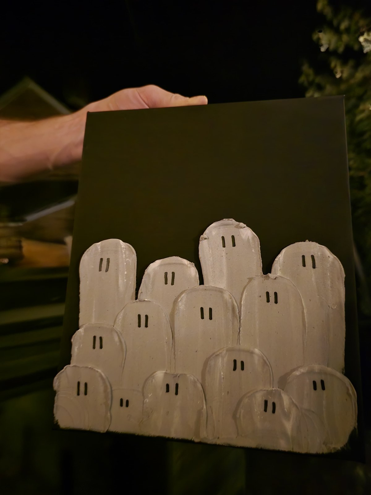
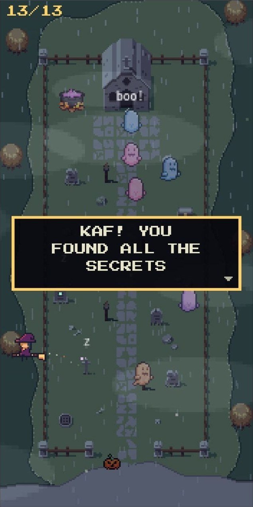

I love Halloween, and I've been wanting to get into more crafty stuff, so what better than combining the two? I spent September scrolling Instagram for ideas, saving anything that looked good but simple, and the one I settled on was [this reel by soxlvr_aye](https://www.instagram.com/reel/Db1mNX3isTd/): a crowd of chunky little ghosts, spread onto a dark canvas with a palette knife.

{: width="240" .left}

I made three. One each for my friends Emma and Kaf, in exchange for them sending me craft projects of their own, and a third to keep for ourselves. I wanted each one to be a different colour from the start. Here are Emma's (top) and Kaf's (bottom) on our shelves, before they went off in the post.

## How I made them

The canvases are from Aldi, and the "paint" is spackle with acrylic paint mixed in. I split a tub of spackle three ways into separate pots and coloured each one: white, silver and blue. Even the white one got some white paint, because it made the spackle much easier to spread.

The technique couldn't be simpler. Load some spackle onto the palette knife, put it on the canvas, and drag it down. That's one ghost. The only trick is getting the right amount on the knife, and even then it's pretty difficult to fuck up. Each canvas only took a few minutes, and there was an element of "that'll do".

After a couple of hours' drying, the eyes took a few seconds each with a marker pen: gold on the white ghosts, black on the silver ones. The silver is meant to be silver, but it came out looking more like grey.

The blue one stayed with us, I'm just too lazy to take a photo of it. Emma and Kaf both sent me photos once theirs had arrived, though:

_Kaf's, on their wall. Photo by Kaf_

_Emma's, out after dark. Photo by Emma_

## The easter egg

{: width="240" .right}

I couldn't just send a painting, though. Stuck to the back of each canvas is an NFC sticker. Scan it with your phone and it opens [haunted.maker.rip](https://haunted.maker.rip/), a tiny pixel-art cemetery I built with Claude in the [Phaser](https://phaser.io) game engine. There's no real gameplay, just things to tap: cats to pet, tombstones whose ghosts rise when you knock, a well that brings the rain, and 13 secrets to find.

The tags are [NTAG215 stickers](https://www.amazon.co.uk/dp/B0CX52TCTG), 2.5cm across, and I wrote them from my iPhone using [NFC21](https://www.nfc-tag-shop.de/en/). Each tag has its own URL parameter, so the game greets Emma and Kaf by name, with a line written just for them.

I'd warned them both there was an easter egg, and the tag is pretty obvious on the back, but each still needed a little help getting it to scan. Emma's phone case was too thick to read the tag through the canvas and spackle, and Kaf just needed a pointer to hold their phone right up against it. After that, Kaf got stuck in, and excitedly sent me proof of finishing it: the screenshot here, with all 13 secrets found.

On Halloween I shared the game with a bunch of other friends too, and some of them got their own personalised welcome. There's more to say about how it works, so it might get a post of its own.

## That'll do

As a way into more crafty stuff, I'm really pleased with how these turned out. They're cheap, quick and almost impossible to get wrong, so if you fancy a bit of Halloween decor, grab a canvas, a tub of spackle and a palette knife, and give it a go. You don't need to hide a game on the back, but I'd recommend it.

And the swap's already complete: Emma sent me some whittled wooden ghosts, and Kaf a Fimo clay figurine. Happy (belated) Halloween! 👻

---

_The ghost painting idea came from [soxlvr_aye's reel](https://www.instagram.com/reel/Db1mNX3isTd/). The game's sprites are by Dyru, angrysnail, kamioo, daydream.cappuccino and Maxence Jacquot. Kaf's photos are cropped: the game screenshot down to just the game, and the wall photo to the canvas._
